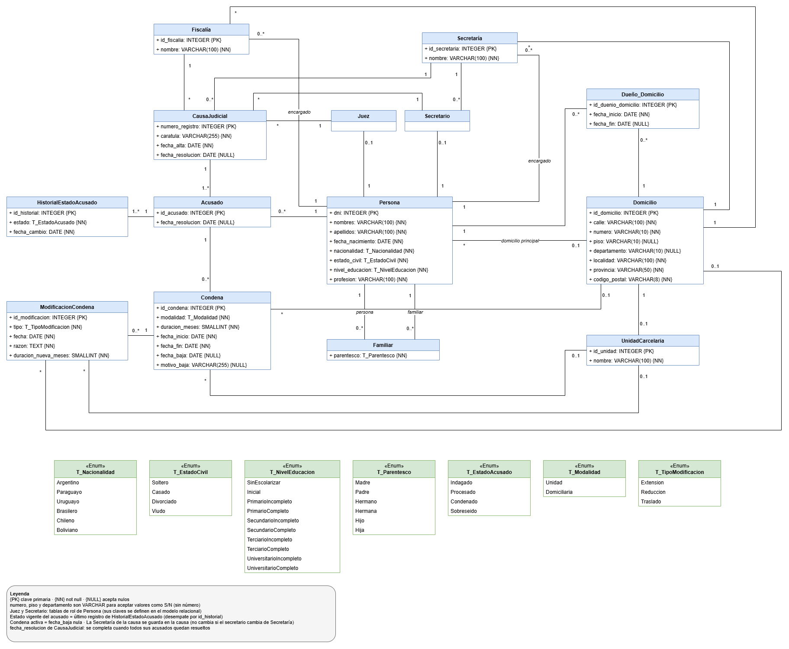

# Sistema de Justicia: Trabajo Práctico Final de Base de Datos


Diseño e implementación de una base de datos para la administración de **causas judiciales y unidades carcelarias**. El trabajo cubre el ciclo completo de creación de una base de datos: reglas de negocio, modelo lógico y relacional, diccionario de datos, triggers, y la posterior implementación en PostgreSQL con vistas, funciones, usuarios y pruebas.

> **Cátedra:** Base de Datos · **Carrera:** Licenciatura en Sistemas de Información
> **Institución:** Facultad de Ciencia y Tecnología, UADER · **Ciclo lectivo:** 2026

---

## Tabla de contenidos

1. [Contexto y consigna](#contexto-y-consigna)
2. [Estado del proyecto](#estado-del-proyecto)
3. [Estructura del repositorio](#estructura-del-repositorio)
4. [Modelo de datos](#modelo-de-datos)
5. [Diccionario de datos](#diccionario-de-datos)
6. [Triggers](#triggers)
7. [Consultas a resolver](#consultas-a-resolver)
8. [Hoja de ruta](#hoja-de-ruta)
9. [Tecnologías](#tecnologías)
10. [Equipo y cátedra](#equipo-y-cátedra)

---

## Contexto y consigna

El sistema de justicia del país necesita un sistema administrativo para gestionar sus causas judiciales y unidades carcelarias. La propuesta elegida plantea las siguientes reglas de negocio:

- **Personas:** se registran DNI, nombres y apellidos, fecha de nacimiento, nacionalidad, estado civil, nivel de educación y profesión, junto con sus familiares directos (madre, padre, hermanos e hijos) y los domicilios a su nombre, diferenciando el domicilio principal.
- **Domicilios:** cada uno registra su dirección, su dueño actual y sus dueños anteriores.
- **Causas judiciales:** cuentan con número interno de registro, secretaría y fiscalía, juez y secretario designados, acusados, fechas de alta y resolución, y el estado procesal de cada acusado (indagado, procesado, condenado o sobreseído).
- **Estados de un acusado:** solo puede avanzar en orden (Indagado → Procesado → Condenado o Sobreseído), sin pasar de un extremo a otro.
- **Condenas:** se asocian a la persona condenada, a la causa que las originó y a la unidad carcelaria donde se cumplen. En caso de prisión domiciliaria, el destino pasa a ser el domicilio principal de la persona. Registran cada modificación (extensión, reducción o traslado) con su razón.
- **Libertad:** la condena se da de baja, pero permanece registrada.

### Alcance solicitado por la cátedra

| Sección | Contenido |
|---|---|
| **1. Modelos** | Modelo lógico (diagrama de clases con claves primarias, dominios, restricciones y cardinalidades) y modelo relacional normalizado hasta la 3FN. |
| **2. Diccionario y triggers** | Diccionario de datos en el formato provisto por la cátedra y definición de los triggers a implementar. |
| **3. Implementación** | Script de creación, triggers (mínimo 4), carga de datos (al menos 15 filas por tabla), vistas (mínimo 3), funciones o procedimientos (mínimo 4), usuarios con distintos permisos (mínimo 2) y script de pruebas. |

---

## Estado del proyecto

| Entrega | Contenido | Estado |
|---|---|---|
| **1ª entrega** | Modelo lógico y modelo relacional en 3FN | ✅ Entregada |
| **2ª entrega** | Diccionario de datos y triggers | ✅ Entregada |
| **3ª entrega** | Plan de la sección 3: consultas, vistas, restricciones, triggers y SP/funciones, usuarios y permisos, poblado y testing | ⏳ En proceso |
| **Implementación** | Scripts de creación, carga, vistas, funciones, usuarios y pruebas en PostgreSQL | ⏳ En proceso |

---

## Estructura del repositorio

```text
TP-Final-Base-de-Datos/
├── Entregas/
│   ├── 1er-Entrega/
│   │   ├── DiagramaClases_BDD_TPFINAL.drawio        # Modelo lógico (diagrama de clases)
│   │   ├── DiagramaClases_BDD_TPFINAL.png           # Exportación del diagrama
│   │   └── MapeoModeloConceptual-Relacional.sql     # Modelo relacional (conceptual)
│   └── 2da-Entrega/
│       ├── BDDTPFinal-Diccionario-Datos.xlsx        # Diccionario de datos
│       └── Triggers Documento.pdf                   # Documentación de triggers
└── README.md
```

---

## Modelo de datos

### Modelo lógico

Diagrama de clases con claves primarias, dominios, restricciones de cada atributo y cardinalidad de las relaciones. El archivo editable se encuentra en [`DiagramaClases_BDD_TPFINAL.drawio`](Entregas/1er-Entrega/DiagramaClases_BDD_TPFINAL.drawio).



### Modelo relacional

El modelo relacional está normalizado hasta la **3FN** y se encuentra en [`MapeoModeloConceptual-Relacional.sql`](Entregas/1er-Entrega/MapeoModeloConceptual-Relacional.sql).

> **Nota:** este archivo es una representación **conceptual** del esquema relacional (no es un script ejecutable en PostgreSQL). El script de creación se incluirá en la etapa de implementación.

El esquema se compone de **14 tablas** y **7 dominios enumerados**, organizados en cuatro áreas:

| Área | Tablas | Descripción |
|---|---|---|
| **Personas y domicilios** | `persona`, `familiar`, `domicilio`, `duenioDomicilio` | Datos personales, vínculos familiares directos, domicilios y su historial de titularidad. |
| **Estructura judicial** | `juez`, `secretaria`, `secretario`, `fiscalia`, `unidadCarcelaria` | Roles y organismos que intervienen en el sistema. |
| **Proceso judicial** | `causaJudicial`, `acusado`, `historialEstadoAcusado` | Causas, personas acusadas y la evolución de su estado procesal. |
| **Ejecución penal** | `condena`, `modificacionCondena` | Condenas, su cumplimiento y los cambios que sufren. |

### Decisiones de diseño

- **Edad como dato derivado:** no se almacena; se calcula a partir de `fecha_nacimiento`.
- **Historial de estados:** el estado vigente de un acusado es el último registro de `historialEstadoAcusado`, lo que conserva la trazabilidad completa del proceso.
- **Titularidad de domicilios con períodos:** `duenioDomicilio` guarda fecha de inicio y fin; el dueño actual es el que tiene `fecha_fin` nula.
- **Baja lógica de condenas:** una condena nunca se elimina; se da de baja con `fecha_baja` y `motivo_baja`.
- **Modificaciones inmutables:** cada extensión, reducción o traslado se registra en `modificacionCondena` junto con su razón, y no puede editarse ni borrarse.
- **Destino de la condena:** según la modalidad, la condena referencia una `unidadCarcelaria` o el domicilio principal de la persona.

---

## Diccionario de datos

El archivo [`BDDTPFinal-Diccionario-Datos.xlsx`](Entregas/2da-Entrega/BDDTPFinal-Diccionario-Datos.xlsx) sigue el formato provisto por la cátedra e incluye, para cada tabla:

- Descripción de la tabla y de cada atributo.
- Dominio, rango, restricciones (`NOT NULL`, `UNIQUE`), valor por defecto, clave primaria y claves foráneas.
- Triggers asociados, con su descripción y operaciones vinculadas.

También define los **7 dominios enumerados**: `T_Nacionalidad`, `T_EstadoCivil`, `T_NivelEducacion`, `T_Parentesco`, `T_EstadoAcusado`, `T_Modalidad` y `T_TipoModificacion`.

---

## Triggers

Se diseñaron **8 triggers** (la consigna exige un mínimo de 4) para garantizar reglas de negocio que las restricciones declarativas no pueden expresar. El detalle de cada uno, con su descripción, justificación y tabla de retornos, está en [`Triggers Documento.pdf`](Entregas/2da-Entrega/Triggers%20Documento.pdf).

| Trigger | Tabla | Operación | Regla que garantiza |
|---|---|---|---|
| `trg_validar_transicion_estado` | `historialEstadoAcusado` | BEFORE INSERT OR UPDATE OR DELETE | El acusado avanza Indagado → Procesado → Condenado/Sobreseído, sin saltos ni retrocesos; el historial es inmodificable. |
| `trg_cerrar_resolucion` | `historialEstadoAcusado` | AFTER INSERT | Completa la fecha de resolución del acusado y, cuando todos están resueltos, la de la causa. |
| `trg_validar_alta_condena` | `condena` | BEFORE INSERT | El acusado debe estar Condenado; modalidad, destino, duración y fechas deben ser coherentes. |
| `trg_validar_modificacion_condena` | `modificacionCondena` | BEFORE INSERT OR UPDATE OR DELETE | Cada extensión, reducción o traslado exige los datos propios de su tipo y es coherente con la condena vigente. |
| `trg_proteger_condena` | `condena` | BEFORE UPDATE OR DELETE | Las condenas no se eliminan; el único cambio permitido es su baja. |
| `trg_validar_duenio_domicilio` | `duenioDomicilio` | BEFORE INSERT OR UPDATE OR DELETE | La titularidad es una línea de tiempo sin superposiciones ni dos dueños actuales. |
| `trg_validar_familiar` | `familiar` | BEFORE INSERT OR UPDATE | Sin autorrelación, con parentesco inverso compatible y fechas de nacimiento coherentes. |
| `trg_validar_acusado` | `acusado` | BEFORE INSERT OR UPDATE y AFTER INSERT | El juez o secretario de la causa no puede ser acusado en ella; no se agregan acusados a causas resueltas; registra el estado inicial Indagado. |

---

## Consultas a resolver

La propuesta plantea seis consultas que serán resueltas mediante vistas, funciones o procedimientos almacenados:

| N.º | Consulta |
|---|---|
| **A** | Listar todas las causas, clasificadas por estado, de una secretaría en particular durante los últimos 6 meses. |
| **B** | Mostrar los condenados que hayan sufrido al menos 5 extensiones o reducciones de condena para una secretaría en particular. |
| **C** | Listar todas las causas donde haya familiares directos involucrados. |
| **D** | Mostrar la cantidad de personas en prisión domiciliaria a la fecha actual de consulta. |
| **E** | Mostrar las personas que hayan sido condenadas y sobreseídas (ambas) en algún momento. |
| **F** | Mostrar todas las condenas vencidas donde haya habido más de 3 traslados de unidad carcelaria. |

---

## Hoja de ruta

- [x] Modelo lógico (diagrama de clases)
- [x] Modelo relacional normalizado (3FN)
- [x] Diccionario de datos
- [x] Diseño y documentación de triggers
- [ ] Plan de la sección 3 (consultas, vistas, SP/funciones, usuarios, poblado y testing)
- [ ] Script de creación de la base de datos
- [ ] Script de triggers
- [ ] Script de carga de datos (al menos 15 filas por tabla)
- [ ] Script de vistas (mínimo 3)
- [ ] Funciones y procedimientos (mínimo 4)
- [ ] Usuarios y permisos (mínimo 2 niveles)
- [ ] Script de pruebas de triggers y funciones

---

## Tecnologías

- **PostgreSQL**: motor de base de datos de destino para la implementación.
- **draw.io**: modelado del diagrama de clases.
- **Microsoft Excel**: diccionario de datos.

---

## Equipo y cátedra

**Alumnos**

- Sosa Mariano
- Sotelo Benjamín
- Loker Lisandro
