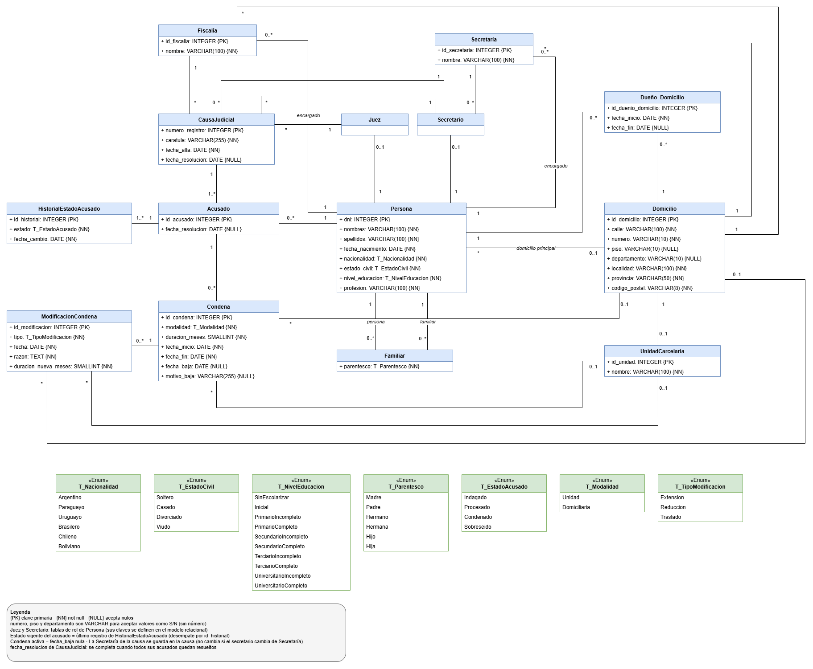

# Sistema de Justicia: Trabajo Práctico Final de Base de Datos


Diseño e implementación de una base de datos para la administración de **causas judiciales y unidades carcelarias**. El trabajo cubre el ciclo completo de creación de una base de datos: reglas de negocio, modelo lógico y relacional, diccionario de datos, triggers, restricciones, y la posterior implementación en PostgreSQL con vistas, funciones, procedimientos, usuarios y pruebas.

> **Cátedra:** Base de Datos · **Carrera:** Licenciatura en Sistemas de Información
> **Institución:** Facultad de Ciencia y Tecnología, UADER · **Ciclo lectivo:** 2026

---

## Tabla de contenidos

1. [Contexto y consigna](#contexto-y-consigna)
2. [Estructura del repositorio](#estructura-del-repositorio)
3. [Modelo de datos](#modelo-de-datos)
4. [Diccionario de datos](#diccionario-de-datos)
5. [Alcance del proyecto](#alcance-del-proyecto)
6. [Consultas a resolver](#consultas-a-resolver)
7. [Tecnologías](#tecnologías)
8. [Equipo y cátedra](#equipo-y-cátedra)

---

## Contexto y consigna

El sistema de justicia del país necesita un sistema administrativo para gestionar sus causas judiciales y unidades carcelarias. La propuesta elegida plantea las siguientes reglas de negocio:

- **Personas:** se registran DNI, nombres y apellidos, fecha de nacimiento, nacionalidad, estado civil, nivel de educación y profesión, junto con sus familiares directos (madre, padre, hermanos e hijos) y los domicilios a su nombre, diferenciando el domicilio principal.
- **Domicilios:** cada uno registra su dirección, su dueño actual y sus dueños anteriores.
- **Causas judiciales:** cuentan con número interno de registro, secretaría y fiscalía, juez y secretario designados, acusados, fechas de alta y resolución, y el estado procesal de cada acusado (indagado, procesado, condenado o sobreseído).
- **Estados de un acusado:** solo puede avanzar en orden (Indagado → Procesado → Condenado o Sobreseído), sin pasar de un extremo a otro.
- **Condenas:** se asocian a la persona condenada, a la causa que las originó y a la unidad carcelaria donde se cumplen. En caso de prisión domiciliaria, el destino pasa a ser el domicilio principal de la persona. Registran cada modificación (extensión, reducción o traslado) con su razón.
- **Libertad:** la condena se da de baja, pero permanece registrada.

### Alcance solicitado por la cátedra

| Sección | Contenido |
|---|---|
| **1. Modelos** | Modelo lógico (diagrama de clases con claves primarias, dominios, restricciones y cardinalidades) y modelo relacional normalizado hasta la 3FN. |
| **2. Diccionario y triggers** | Diccionario de datos en el formato provisto por la cátedra y definición de los triggers a implementar. |
| **3. Implementación** | Script de creación, triggers (mínimo 4), carga de datos (al menos 15 filas por tabla), vistas (mínimo 3), funciones o procedimientos (mínimo 4), usuarios con distintos permisos (mínimo 2) y script de pruebas. |

---

## Estructura del repositorio

```text
TP-Final-Base-de-Datos/
├── Entregas/
│   ├── 1er-Entrega/
│   │   ├── DiagramaClases_BDD_TPFINAL.drawio     # Modelo lógico (diagrama de clases)
│   │   ├── DiagramaClases_BDD_TPFINAL.png        # Exportación del diagrama
│   │   └── MapeoModeloConceptual-Relacional.sql  # Modelo relacional (conceptual)
│   ├── 2da-Entrega/
│   │   ├── BDDTPFinal-Diccionario-Datos.v2.xlsx  # Diccionario de datos (v2)
│   │   └── Triggers Documento.v2.pdf             # Documentación de triggers (v2)
│   └── 3er-entrega/
│       └── Plan de Implementación de la Base de Datos del Sistema de Justicia.v2.pdf
└── README.md
```

---

## Modelo de datos

### Modelo lógico

Diagrama de clases con claves primarias, dominios, restricciones de cada atributo y cardinalidad de las relaciones. El archivo editable se encuentra en [`DiagramaClases_BDD_TPFINAL.drawio`](Entregas/1er-Entrega/DiagramaClases_BDD_TPFINAL.drawio).



### Modelo relacional

El modelo relacional está normalizado hasta la **3FN** y se encuentra en [`MapeoModeloConceptual-Relacional.sql`](Entregas/1er-Entrega/MapeoModeloConceptual-Relacional.sql).

> **Nota:** este archivo es una representación **conceptual** del esquema relacional (no es un script ejecutable en PostgreSQL). El script ejecutable de creación se desarrolla en la etapa de implementación.

El esquema se compone de **14 tablas** y **7 dominios enumerados**, organizados en cuatro áreas:

| Área | Tablas | Descripción |
|---|---|---|
| **Personas y domicilios** | `persona`, `familiar`, `domicilio`, `duenioDomicilio` | Datos personales, vínculos familiares directos, domicilios y su historial de titularidad. |
| **Estructura judicial** | `juez`, `secretaria`, `secretario`, `fiscalia`, `unidadCarcelaria` | Roles y organismos que intervienen en el sistema. |
| **Proceso judicial** | `causaJudicial`, `acusado`, `historialEstadoAcusado` | Causas, personas acusadas y la evolución de su estado procesal. |
| **Ejecución penal** | `condena`, `modificacionCondena` | Condenas, su cumplimiento y los cambios que sufren. |

### Decisiones de diseño

- **Edad como dato derivado:** no se almacena; se calcula a partir de `fecha_nacimiento`.
- **Historial de estados:** el estado vigente de un acusado es el último registro de `historialEstadoAcusado`, lo que conserva la trazabilidad completa del proceso.
- **Titularidad de domicilios con períodos:** `duenioDomicilio` guarda fecha de inicio y fin; el dueño actual es el que tiene `fecha_fin` nula.
- **Baja lógica de condenas:** una condena nunca se elimina; se da de baja con `fecha_baja` y `motivo_baja`.
- **Modificaciones inmutables:** cada extensión, reducción o traslado se registra en `modificacionCondena` junto con su razón, y no puede editarse ni borrarse.
- **Destino de la condena:** según la modalidad, la condena referencia una `unidadCarcelaria` o el domicilio principal de la persona.
- **Reglas en CHECK o en trigger:** las reglas que dependen solo de una fila se resuelven con restricciones `CHECK`; las que consultan otras tablas o el historial, con triggers.
- **Estados finales alternativos:** Condenado y Sobreseído no se encadenan dentro de una misma causa. La consulta E se interpreta como personas condenadas en una causa y sobreseídas en otra.

---

## Diccionario de datos

El archivo [`BDDTPFinal-Diccionario-Datos.v2.xlsx`](Entregas/2da-Entrega/BDDTPFinal-Diccionario-Datos.v2.xlsx) sigue el formato provisto por la cátedra e incluye, para cada tabla:

- Descripción de la tabla y de cada atributo.
- Dominio, rango, restricciones (`NOT NULL`, `UNIQUE`, `CHECK`), valor por defecto, clave primaria y claves foráneas.
- Triggers asociados, con su descripción y operaciones vinculadas.

También define los **7 dominios enumerados**: `T_Nacionalidad`, `T_EstadoCivil`, `T_NivelEducacion`, `T_Parentesco`, `T_EstadoAcusado`, `T_Modalidad` y `T_TipoModificacion`.

---

## Alcance del proyecto

La implementación en PostgreSQL comprende los siguientes componentes:

| Componente | Cantidad | Qué incluye |
|---|---|---|
| Tablas | 14 | Claves primarias, claves foráneas y restricciones `NOT NULL` y `UNIQUE`, agrupadas en cuatro áreas: personas y domicilios, estructura judicial, proceso judicial y ejecución penal. |
| Dominios enumerados | 7 | Nacionalidad, estado civil, nivel educativo, parentesco, estado del acusado, modalidad de la condena y tipo de modificación. |
| Restricciones `CHECK` | 10 | Reglas de una sola fila: duración positiva, fecha de fin coherente, baja completa, destino según la modalidad, razón no vacía, familiar distinto de la persona y período de titularidad válido. |
| Triggers | 8 | Reglas que consultan otras tablas o el historial: `trg_validar_transicion_estado`, `trg_cerrar_resolucion`, `trg_validar_alta_condena`, `trg_validar_modificacion_condena`, `trg_proteger_condena`, `trg_validar_duenio_domicilio`, `trg_validar_familiar` y `trg_validar_acusado`. |
| Vistas | 4 | `v_condena_vigente`, `v_causas_con_familiares`, `v_personas_condenadas_y_sobreseidas` y `v_condenas_vencidas_con_traslados`. |
| Funciones | 4 | `fn_causas_por_estado`, `fn_condenados_con_modificaciones`, `fn_cantidad_prision_domiciliaria` y `fn_calcular_edad`. |
| Procedimientos | 1 | `sp_registrar_condena`, que registra una condena aplicando sus validaciones. |
| Usuarios y roles | 3 usuarios, 3 roles | Administrador, operador y consulta, con permisos diferenciados sobre tablas, vistas y funciones. |
| Datos de prueba | 324 filas | Cargadas en las 14 tablas, con casos diseñados para que cada consulta tenga un resultado esperado. |
| Pruebas | 1 script | Verifican consultas, restricciones, triggers, vistas, funciones, procedimiento y permisos. |

### Scripts de implementación

| Orden | Script | Contenido |
|---|---|---|
| 00 | `00_reset.sql` | Vacía la base para volver a cargar datos y repetir pruebas. |
| 01 | `01_crear_bd.sql` | Esquema, tipos enumerados, tablas y restricciones. |
| 02 | `02_triggers.sql` | Los 8 triggers. |
| 03 | `03_carga_datos.sql` | Carga de datos de las 14 tablas, en una única transacción. |
| 04 | `04_vistas.sql` | Las 4 vistas. |
| 05 | `05_funciones_procedimientos.sql` | Las 4 funciones y el procedimiento. |
| 06 | `06_usuarios_permisos.sql` | Roles, usuarios y permisos. |
| 07 | `07_pruebas.sql` | Pruebas de todos los componentes. |

El detalle de cada trigger, con su descripción, justificación y tabla de retornos, está en el [documento de triggers](Entregas/2da-Entrega/Triggers%20Documento.v2.pdf). El plan completo de implementación, con consultas, vistas, permisos, poblado y testing, está en el [plan de implementación](Entregas/3er-entrega/Plan%20de%20Implementaci%C3%B3n%20de%20la%20Base%20de%20Datos%20del%20Sistema%20de%20Justicia.v2.pdf).

---

## Consultas a resolver

La propuesta plantea seis consultas que se resuelven mediante vistas, funciones o el procedimiento almacenado:

| N.º | Consulta |
|---|---|
| **A** | Listar todas las causas, clasificadas por estado, de una secretaría en particular durante los últimos 6 meses. |
| **B** | Mostrar los condenados que hayan sufrido al menos 5 extensiones o reducciones de condena para una secretaría en particular. |
| **C** | Listar todas las causas donde haya familiares directos involucrados. |
| **D** | Mostrar la cantidad de personas en prisión domiciliaria a la fecha actual de consulta. |
| **E** | Mostrar las personas que hayan sido condenadas y sobreseídas (ambas) en algún momento. |
| **F** | Mostrar todas las condenas vencidas donde haya habido más de 3 traslados de unidad carcelaria. |

---

## Tecnologías

- **PostgreSQL**: motor de base de datos de destino para la implementación.
- **draw.io**: modelado del diagrama de clases.
- **Microsoft Excel**: diccionario de datos.

---

## Equipo y cátedra

**Alumnos**

- Sosa Mariano
- Sotelo Benjamín
- Loker Lisandro

**Docentes**

- Ing. Esteban Schab
- Gabriel Casares
- Tomas Viñuela
